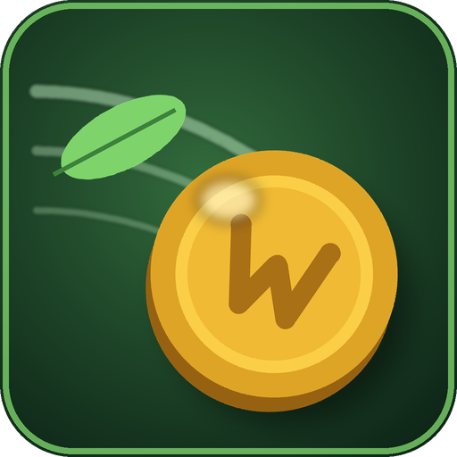

# Windfall

A World of Warcraft Forever addon for making and spending gold well: what your farming is worth per hour, priced with Auctionator's scans; a guided, priced route to level any crafting profession, with buying and crafting from the same window; and a one-button fishing key.

## Getting around

- **Windfall lives in the game's profession window**, as a tab with the profession tabs on its right side. The Windfall icon on the bar, the key binding and `/wf` open the window on it.
- **At the top** pick any of your characters (it opens on the one you are playing) and one of the icons: their crafting professions, **Fishing** and **Farming**. A skill bar shows where that profession is. The gear holds the general settings.
- **Tabs under the window** change with the icon: **Recipes** and **Levelling** for crafting; **Session** and **Zones** for Farming; **Fishing** (and **Recipes** for Camping) for Fishing.
- **The bar** stays on screen: your gold per hour and session time (click for the Session page), a fish switch (fishing key on or off, right-click to choose the key), a flower switch (node sparkles on or off), and the Windfall icon. Drag it wherever you like.
- **The shopping list** docks next to the auction house or a vendor when there is something on it to buy there; *Shopping list* on the Levelling page opens it beside the profession window.

## Farming

- **Two views:** *Gathering* counts only herbs, ore, skins and fish (mob loot does not pull your rate down). *All loot* counts everything you loot, plus coins. Switch on the Session page or by right-clicking the gold per hour on the bar; nothing is lost when you switch.
- **Prices:** Auctionator's last scanned price, or the vendor price when that is higher or the item was never scanned.
- **Calm numbers:** updated when you loot something or once a minute.
- **Zones:** Reset saves the session per zone. The Zones tab ranks zones by gold per hour, so you can tell which spot is worth farming.

## Professions

Every recipe a character knows, on every character you play, in the profession window's own layout: the list on the left (with how many you can make), the picked recipe on the right with its reagents, how many that character has and needs, what your other characters hold, the cost (the cheaper of the auction house and a vendor), what the result sells for after the 5% auction house cut, and the profit. Characters are listed by their full name as soon as you log in; their recipes are read when you open a profession window, or with Load. Each character's bags are saved as they change and its bank whenever you open it, so you can see any character's materials from any other.

Levelling takes the cheapest way up from your skill. It mixes the recipes you know with the ones the trainer can teach you now and ranks them by what a skill point costs, using each recipe's real skill-up chance from the game's own data (a point every time while orange, less and less until grey). Sure points come first; low-chance crafts only when nothing better is left.

The **Levelling** tab plays that forward for the picked profession, up to the next skill cap (the shopping list's **Plan to 150** plans further): every step up to the target, the ranks to train on the way (or the book or quest for Cooking and First Aid, and a note when your level is too low), and all the materials with a spare for unlucky skill-ups, in the shopping list:

- **The route:** every step with how many to craft; pick one to see its reagents and Create it. It moves on by itself as your skill goes up, when you learn a recipe and when you train a rank.
- **At the auction house:** **Show** opens a material's page in the auction house with the amount you still need filled in; you press Buy Now there.
- **At a vendor:** **Buy** buys what you still need of anything the vendor sells, and **Buy all here** buys all of it at once.

Works for Alchemy, Blacksmithing, Cooking, Enchanting, Engineering, First Aid, Leatherworking and Tailoring.

Trainer recipe data comes from **What's Training?** by Sveng (MIT licence) and skill-up levels from the game's own recipe table; see `Data/THIRD_PARTY.md`. `tools/import_recipes.py` rebuilds the recipe list.

## Node sparkles

Switched on from the bar, the gear or Farming's Session page, the nearest herb, ore vein or fishing pool you can gather gets a sparkle and the game's gather icon. Quest objects, chests and NPCs get nothing. Each kind can be switched off on its own. The game only picks up nodes within about 15 yards.

When Windfall is done with the interact key (the line comes in, or sparkles are switched off), it puts it back to the game's defaults: 10 yards, in front of you. The rest of the time it leaves the interact settings alone, so other addons can set them as they like.

## Fishing key

- **One key:** while on, a press casts Fishing and the next press reels in the bobber. Off, the key does whatever it normally does. Keyboard keys, mouse buttons and the wheel all work.
- **Lures:** puts the best lure your skill allows on the pole when it has none.
- **Pole:** equips your best fishing pole when you switch on, and puts your weapons back when you switch off.
- **Louder splash:** sound effects to full and music and ambience to a quarter while the line is out.
- **Also:** double right-click to cast, auto loot while fishing, switches off after 10 idle minutes, and a line telling you how many fish get away in the zone you are in.

Every option is a checkbox on Fishing's **Fishing** tab.

## Commands

| Command | What it does |
|---|---|
| `/wf` | Open or close Windfall in the profession window |
| `/wf prof`, `/wf session`, `/wf zones`, `/wf settings` | Open that page |
| `/wf gather`, `/wf loot` | Switch view |
| `/wf start`, `/wf pause` | Start or pause the clock |
| `/wf reset` | Save the session to the zone history and start over (`/wf discard` throws it away) |
| `/wf fish` | Fishing key on or off |
| `/wf fishkey` | Choose the fishing key |
| `/wf sparkle` | Node sparkles on or off |

Key bindings for the fishing switch, node sparkles and the window are under Options > Keybindings > AddOns > Windfall.

## Development

- `tools/sim_test.py` runs the addon against a stubbed game API and prints a simulated session.
- `tools/make_icon.py` draws `Media/icon.tga` and `docs/icon-512.png`.
